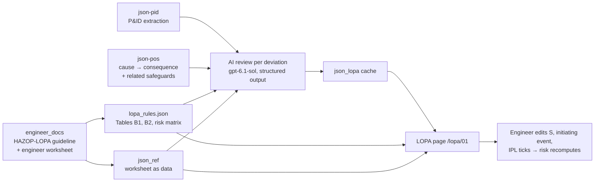

# Backward IPL Review — Demo Summary

**Project:** Super NODE · SuperNode reasoning approach for HAZOP analysis
**Case 01:** Naphtha Tank Storage (100T-01) with Naphtha Transfer Pump (100P-01A/B)
**Status (2026-10-22):** partial working demo; cached AI results cover 5 of 9 deviations and 24 of 39 causes. The original run notes attribute the remaining runs to exhausted API credit; account status was not rechecked.
**Review conclusion (2026-10-22):** useful for demonstrating backward IPL reasoning and conditional risk calculations. The current results do not establish complete or verified process protection. See Section 10 for evidence, findings, and acceptance checks.

---

## 1. Objective

> เขียน backward คือวิเคราะห์ cause-conseq เหตุการณ์ที่เกิดขึ้นและไม่มี ipl ให้ทำการเติม ipl ที่เหมาะสมในระบบ และวิเคราะห์ว่าสามารถลดระดับของความอันตรายอะไรลงได้บ้าง
> AI ที่ช่วยเติมและปรับปรุง ระบบ IPLs, Safety สามารถช่วยปรับปรุง HAZOP วิเคราะห์การเพิ่ม การปรับปรุงในแนว IPLs และเหตุที่เกิดขึ้นในแนว safety
> คิดย้อนกลับว่า process นี้มี Protection ดีแล้วหรือยัง ครบหรือยัง ปรับปรุงเพียงพอแล้วหรือยัง

Reason **backward** from each cause → consequence scenario with missing or insufficient protection, let AI **propose suitable IPLs**, show **which calculated risk levels could drop**, and support the engineer in answering three questions for the process:

1. Is the protection **good**?
2. Is it **complete**?
3. Is the **improvement enough**?

---

## 2. What the demo does

For every cause in json-pos the AI works backward from the worst consequence (all safeguards ignored) and returns:

- **Severity** C-1…C-5, with reason
- **Initiating event** from Table B1 (or *not credible*, per the guideline's exclusions), with reason
- **Every existing safeguard it evaluated**, each judged *independent / effective / auditable*, with an IPL type from Table B2 and a reason
- **Proposed new IPLs** (Table B2 types, existing or `new` tags) when risk is still I or II
- The **matching engineer worksheet row** (if any) and a short **verdict**

---

## 3. Method — "AI judges, rules compute"

| Step | Done by | Source |
|---|---|---|
| Severity, initiating event, I/E/A judgement, IPL type, proposals | **AI** | json-pid, json-pos, guideline rules in the prompt |
| IPL credit per type | **Code** | Table B2 (`lopa_rules.json`) |
| Frequency category F-1…F-5 | **Code** | initiating frequency × 0.1^credits |
| Risk rank I–IV | **Code** | Appendix G company risk matrix |
| Final say | **Engineer** | edits on the page |

The structured schema has no dedicated numeric credit or risk-rank fields; the displayed stages are calculated from `lopa_rules.json`. AI explanations and verdicts do contain numbers and risk ranks, so their prose must be checked against the computed result. Reproducible arithmetic does not by itself validate the selected severity, initiating event, independence, or applicability of a table credit.

**Required IPL criteria** — a safeguard should earn credit only if it is:
- **Independent** of the initiating cause and of every other credited IPL (shared sensor / logic / final element = one layer)
- **Effective** — designed for this scenario and able to act in time
- **Auditable** — tested and maintained so its PFD can be validated

The current evaluator checks these AI-supplied booleans for existing safeguards by default. Engineer checkbox overrides can bypass them; proposed IPLs are included automatically without equivalent qualification fields. Shared-component independence is instructed in the prompt but is not enforced by the arithmetic (see Section 10).

**Frequency categories:** F-1 ≥ 1e-1; F-2 from 1e-2 to < 1e-1; F-3 from 1e-3 to < 1e-2; F-4 from 1e-4 to < 1e-3; F-5 < 1e-4 per year.

**Risk matrix (Appendix G):**

| | C-1 | C-2 | C-3 | C-4 | C-5 |
|---|---|---|---|---|---|
| **F-1** | IV | II | II | I | I |
| **F-2** | IV | III | II | II | I |
| **F-3** | IV | IV | III | II | I |
| **F-4** | IV | IV | IV | III | II |
| **F-5** | IV | IV | IV | IV | III |

I = Intolerable, II = Undesirable (both: reduce to III) · III = Tolerable with controls · IV = Tolerable as is.

**Worked example (worksheet W1, UV inlet valve closed):** S = C-3, valve failure 0.1/yr → F-1 → **II**. LAL + operator (−1) and IS-10 (−1) → 0.001/yr → F-3 → **III**.
The unit tests reproduce the **mitigated** frequency category and risk rank for every scored worksheet row from its recorded inputs and IPL credits. W10/W11 have inconsistent **unmitigated** ranks, which the tests flag. These checks validate arithmetic against the reference data, not AI judgment or installed protection.

Within a scenario, adding IPL credits changes frequency and risk rank while leaving severity unchanged. A claim that a design change reduces consequence severity needs a separate, justified consequence reassessment.

---

## 4. Data sources

| File | Used for |
|---|---|
| `backend/static/json_pid/01_naphtha_tank_extraction.json` | equipment, valves, instruments, lines (process context for the AI) |
| `backend/static/json_pos/01_casue_consequence_naphtha_tank_connection.json` | 9 deviations, 39 causes, related safeguards per deviation |
| `engineer_docs/HAZOP_LOPA Procedure  for AI HAZOP.pdf` | Table B1 (initiating events), Table B2 (IPL credits), Appendix G risk matrix → `backend/static/lopa_rules.json`; the filename contains two spaces after `Procedure` |
| `engineer_docs/HAZOP Worksheet_Naphtha Tank and Transfer Pump.xlsx` | engineer reference (11 rows W1–W11) → `backend/static/json_ref/01_hazop_worksheet.json` |
| `engineer_docs/P&IDS Naphtha Tank and Transfer Pump.pdf` | cross-check of tags (found the LAL tag error below) |

---

## 5. The LOPA page (`/lopa/01`)

Opened from the **Backward IPL review →** button on the 3D graph page.

- **Three verdict cards** answering *good? complete? enough?* with counts; currently these use only reviewed causes and do not gate a positive verdict on full coverage or engineer approval
- **Risk matrix** in company colours, switchable between *Before IPLs / Existing IPLs / + AI proposals*; an opened row shows its path (B → N → AI)
- **Worksheet per deviation:** cause · consequence · Before · Existing IPLs · Now · AI adds · After · Engineer (W-row) — with a *Run / Re-run AI* button per deviation
- **Expanded row:**
  - Risk inputs: editable severity and initiating event, with AI reasons
  - Existing protection: tick / untick each safeguard, with I/E/A ✓/✗ and reason
  - AI proposed IPLs: tick / untick each proposal, plus the AI verdict and the engineer's worksheet row
  - Any edit recomputes the risk immediately; *Reset to AI judgement* undoes it
- **Worksheet check:** flags engineer rows whose recorded risk disagrees with the matrix

---

## 6. Results so far (case 01)

| | |
|---|---|
| Deviations reviewed | 5 of 9 (No Flow / Less Flow, More Flow, Reverse Flow, High Pressure, Low Pressure) |
| Causes reviewed | 24 of 39 (4 screened out as not credible → 20 credible) |
| Risk I/II before any IPL | 20 of 20 |
| Risk I/II with existing IPLs (AI credit) | 18 of 20 — only 2 reach III/IV |
| Scenarios needing protection with no valid IPL | 11 |
| AI-proposed IPL entries | 19 scenario-level entries; some refer to the same proposed installation |
| Risk I/II after including all proposals | **0 of 20 reviewed credible scenarios, conditional on all assumed credits being valid** |
| Engineer rows linked by AI | W1, W3, W4, W6, W7, W8, W10 (W10 is linked to a screened-out cause) |
| AI time per deviation | 105–216 s |

These counts were recomputed from the cache on 2026-10-22. The 15 unreviewed causes comprise High Level (4), Low Level (4), High Temperature (4), and Low Temperature (3). Excluding all proposed IPLs leaves **18** reviewed credible scenarios at I/II. No actual plant risk reduction has been verified by this demo review.

**Example proposals**
- Low tank level (FLOW-NL-C01/C02): independent low-level alarm on LT-0101 + operator isolation (−1)
- Overfill compressing the vapour space (PRESS-HIGH-C03): overflow line to safe location, no impediment (−3)
- Suction restriction / loss of pump delivery (FLOW-NL-C04/C05): shared proposed SIL 2 low-delivery-flow function to stop 100P-01A/B and close a separate inlet shutdown valve, addressing pump damage and continued-inflow overfill (new FT/FSL/SIS-0103 and UV-0103-IN)
- Nitrogen PCV fails open (PRESS-HIGH-C01): independent high-pressure shutdown of the nitrogen supply
- Pump deadheading (PRESS-HIGH-C04): scenario-sized discharge relief back to the tank

**Findings**
1. **The cached AI review rejects many existing safeguards.** Only 2/20 reviewed credible scenarios reach III/IV with its existing-IPL judgments. Individual explanations cite independence and effectiveness doubts; this aggregate alone does not establish that the AI is more accurate or consistently stricter than the engineer, because scenario matching, severity, and initiating-event choices also differ.
2. **The extracted alarm mapping needs reconciliation.** json-pid calls the low-level alarm *LAL-0102*, and the cache treats it as sharing LT-0102 with LSLL-0102. The P&ID shows LAH/LAL on **LI-0101A**, through LY-0101 from **LT-0101**. Overriding the rejected alarm can move the W1-linked calculation from II to III, but a checkbox does not verify the complete alarm path, operator response time, final-element independence, or testing evidence. Correct the source mapping and reassess those conditions.
3. **Engineer worksheet inconsistency.** W10 and W11 (thermal contraction / expansion) are S4·L2, which the matrix gives as **II**, but the worksheet records **I**.
4. **Screening needs engineering review.** The cache excludes external fire (PRESS-HIGH-C06), an undefined manual-valve error (FLOW-REV-C02), rapid pump-out combined with make-up failure (PRESS-LOW-C03), and ambient cooling (PRESS-LOW-C04, linked to W10). These are AI scope/credibility decisions. The source guideline has exceptions for plant experience and design cases, so exclusion is not proof that the hazard is impossible or adequately protected (see Standards finding S4).

---

## 7. Architecture and files

**Backend (Flask)**

| Endpoint | Purpose |
|---|---|
| `GET /api/lopa/<id>` | rules, engineer reference rows, cached AI review, running jobs, errors, model |
| `POST /api/lopa/<id>/run` `{"deviations": [...]}` | start AI reviews as background jobs (max 3 in parallel); page polls every 4 s |

- `backend/app.py` — routes and background job handling (cache writes are locked)
- `backend/module/lopa.py` — prompt and structured-output schema (OpenAI Responses API)
- `backend/static/lopa_rules.json` — Tables B1, B2 and the risk matrix (single source of truth)
- `backend/static/json_ref/01_hazop_worksheet.json` — engineer worksheet as data
- `backend/static/json_lopa/01_lopa.json` — cached AI results
- `backend/scripts/worksheet_to_json.py` — xlsx → JSON converter (needs `openpyxl`)

**Frontend (Nuxt / Vue / TypeScript)**

- `app/utils/lopa.ts` — risk arithmetic, verdict summary, worksheet consistency check
- `app/pages/lopa/[id].vue` — LOPA page
- `app/components/LopaRow.vue` — worksheet row and editable detail panel
- `app/components/RiskMatrix.vue` — 5×5 risk matrix

**Tests:** `test/unit/lopa.test.ts` (arithmetic, every worksheet row, W10/W11 flag, overrides, screening). Run with `npx vitest run --project unit`.

---

## 8. How to run

1. `backend/.env` must contain `OPENAI_API_KEY` and `OPENAI_MODEL=gpt-6.1-sol` (template: `backend/.env.example`; `.env` is git-ignored).
2. Backend packages are installed in `backend/snlib01` (`flask`, `flask_cors`, `openai`, `python-dotenv`).
3. Start both servers: `npm run dev:o` (Nuxt on :3000, Flask on :5000).
4. Open `http://localhost:3000/lopa/01` and click **Run AI review** for any deviation not yet reviewed.
5. From the project root, refresh the engineer reference after editing the xlsx with:
   `backend\snlib01\Scripts\python.exe backend/scripts/worksheet_to_json.py "engineer_docs/HAZOP Worksheet_Naphtha Tank and Transfer Pump.xlsx" backend/static/json_ref/01_hazop_worksheet.json`
   The selected Python environment needs `openpyxl`.

---

## 9. Limitations and next steps

**Limitations**
- 4 deviations (High/Low Level, High/Low Temperature) still need an AI run — add OpenAI credit, then click *Run AI review*.
- Engineer edits on the page are not saved (only the AI results are cached).
- Results are AI judgement only; every S, initiating event and IPL credit must be confirmed by the HAZOP team.
- Each review sends json-pid / json-pos content and the engineer worksheet rows (SCG Chemicals property) to OpenAI.
- The original demo notes report an API key shared in a chat; its rotation status was not checked during this review.

**Possible next steps**
- Correct the LAH/LAL tags in json-pid and re-run No Flow / Low Level.
- Save engineer edits and export the result as an HAZOP-LOPA worksheet (xlsx, company template).
- Show proposed IPLs on the 3D SuperNode graph as new nodes.
- Measure AI vs engineer agreement (S, L, credited IPLs) in a separate blinded run that withholds worksheet answers from the model; the current reference-assisted run cannot provide an independent accuracy benchmark.

---

## 10. Demo review — 2026-10-22

### Assessment and evidence

The demo demonstrates the intended reasoning sequence: start from a cause and consequence, examine existing protection, propose improvements, and show a reproducible change in calculated risk. Its strongest features are the explicit reasons for rejected safeguards, editable inputs, three-stage risk view, and automatic worksheet consistency check.

The appropriate claim is **an engineer-assisted, reference-assisted proof of concept with conditional risk projections**. Full coverage, justified exclusions, qualified IPLs, and recorded engineering acceptance remain necessary before a positive process-level conclusion is supported.

This review inspected the current source, cached AI output, original worksheet through its converter, and relevant procedure pages. No Git history was available. No paid AI review was triggered, no plant changes were made, and no live browser interaction or engineering design validation was performed. Source locations below are project-relative and refer to the code reviewed on this date.

| Verification | Result and scope |
|---|---|
| Existing unit suite | **26/26 tests passed** in two files with `vitest run --project unit --coverage.enabled=false`; includes LOPA arithmetic and SuperNode tests |
| Cache recalculation | Confirmed 5/9 deviations, 24/39 causes, 4 screened out, 20 credible, 18 existing-protection gaps, 11 without credit, 19 proposal entries, and 0 conditional post-proposal gaps |
| Reviewed-cause identifiers | Each cached deviation contains exactly its expected cause IDs, with no missing, unexpected, or duplicate IDs in this snapshot |
| Worksheet extraction | All 11 freshly converted rows exactly match `json_ref/01_hazop_worksheet.json`; W10/W11 mismatches reproduced |
| Procedure matrix | Visually checked all 25 cells against Appendix G, PDF page 30 / printed page 55; they match the JSON matrix |
| P&ID alarm mapping | Visually checked drawing page 1: LAH/LAL is shown at LI-0101A through LY-0101 from LT-0101 |
| Focused evaluator probes | Confirmed duplicate-layer credits, automatic unqualified proposal credits, and the LOTO unit issue described below |

The procedure PDF combines pages carrying different revision labels. Record the approved governing revision and page provenance when validating the rule table. For an external methodological cross-check, the [HSE functional-safety inspection guide, SIL allocation section](https://www.hse.gov.uk/offshore/assets/docs/functional-safety-inspection-guide.pdf) also calls for justification of claimed IPL failure probabilities; table values alone do not establish the performance of a particular installation.

### Standards

These findings compare behavior with the demo's stated IPL rules and the supplied procedure. No separate repository coding-standard document was found. Priorities concern the reliability of the demo's conclusions.

**S1 — High: proposed IPLs bypass qualification.** `ProposedIpl` has no independence, effectiveness, auditability, or approval fields (`backend/module/lopa.py:34`); `evaluate()` includes every proposal by default (`app/utils/lopa.ts:81`). An unverified SIL 2 proposal changes a C3/valve example from II to III. The procedure requires IPL criteria before counting credits (PDF page 26 / printed page 44). Keep a clearly labelled conditional projection and require recorded qualification before treating proposals as accepted protection.

**S2 — High: shared-component independence is not enforced.** The prompt says shared sensor/logic/final elements count as one layer (`backend/module/lopa.py:64`), but the evaluator sums entries (`app/utils/lopa.ts:89`). Two identical BPCS entries receive two credits, changing C3/valve to III; one entry leaves II. This is a reproduced enforcement gap, not evidence of duplicate credit in the current cache. Add layer identities and dependency checks, including conflicts with the initiating event and engineer overrides.

**S3 — Medium: per-opportunity probability is treated as annual frequency.** `loto_failure` stores `per_year: 0.001` despite its per-opportunity label (`backend/static/lopa_rules.json:55`; Table B1, PDF page 11 / printed page 29). `evaluate()` uses it as annual frequency (`app/utils/lopa.ts:83`). Illustratively, 100 opportunities/year would yield 0.1/year rather than 0.001/year, changing unmitigated C4 from II to I. Add explicit units and an opportunity rate, or disable this event until supported. No cached cause currently selects it.

**S4 — Medium: screening omits procedure exceptions.** The prompt gives blanket exclusion categories (`backend/module/lopa.py:62`). The procedure retains plant-experience/design-case exceptions and a heat-exchanger tube-rupture exception (PDF pages 7–8 / printed pages 14–15). Preserve those conditions and require a documented engineering decision for each exclusion. Reassess the four screened causes, especially ambient cooling linked to W10; this review does not determine their final credibility.

### Spec

These findings assess the three objective questions and the claims made about the demo's results.

**P1 — High: positive process verdicts ignore coverage.** Cards check only zero gap counts (`app/pages/lopa/[id].vue:56–72`). With no reviewed causes, all three conditions evaluate to “Yes”; with the current partial cache, “improvement enough” is positive despite 15 unreviewed causes. Gate conclusions on nonzero, complete coverage and explicitly accepted exclusions; show “Pending review” otherwise.

**P2 — High: zero post-proposal gaps is conditional.** The objective asks whether improvement is sufficient, but proposal rationales still require future validation of sizing, independence, response time, or testing (`backend/static/json_lopa/01_lopa.json:1297`, `:1962`). All proposals are included automatically (S1). Label the result “Projected if all assumptions are validated” and show approved protection separately. The documented 18-to-0 change is a calculation, not demonstrated plant risk reduction.

**P3 — Medium: “complete” means only some credit exists.** The completeness card checks `unprotected === 0` (`app/pages/lopa/[id].vue:65–67`); this counts scenarios with zero existing credits (`app/utils/lopa.ts:110`). A scenario with one credited layer can pass this check while its risk remains I/II. Rename the metric to “Reviewed scenarios with at least one credited IPL,” and define protection completeness separately from both coverage and numerical sufficiency.

**P4 — Medium: worksheet agreement is not independent validation.** The model receives the engineer worksheet answers (`backend/module/lopa.py:97`), and cached reasoning explicitly uses them. Agreement in this mode measures reference-assisted consistency. For manuscript accuracy claims, use held-out cases or a blinded run without worksheet answers, then independently adjudicate scenario links, severity, initiating events, exclusions, and IPL decisions.

**P5 — Medium: 19 entries does not mean 19 installations.** `summarize()` counts proposal entries across scenarios (`app/utils/lopa.ts:113`). Cached rationales explicitly reuse the same installation (`backend/static/json_lopa/01_lopa.json:1381`, `:1665`). The results table now calls these “scenario-level proposal entries.” Add shared recommendation IDs and a scenario-to-recommendation mapping before reporting unique installations or estimating implementation effort.

### Recommended next iteration

1. **Make verdicts reflect evidence.** Separate coverage, projected risk, and engineer-approved risk. Add pending/conditional states and accepted exclusion records. Acceptance checks: empty/partial/all-screened reviews never imply verified protection; unapproved proposals affect only the projection.
2. **Enforce the calculation assumptions.** Address S1–S4, preserve source-page references, and validate returned cause IDs against the requested deviation before caching. Acceptance checks: duplicated/shared layers cannot earn extra independent credit; per-opportunity inputs require an annualization basis; exception cases remain reviewable. Existing tests passing does not cover these gaps.
3. **Resolve source data and finish coverage.** Reconcile LAH/LAL paths across json-pid, json-pos, and the drawing; have the engineer resolve W10/W11 and the screening decisions; then complete the four remaining deviations. Associate each run with input/rule/prompt versions so stale reviews are identifiable after corrections.
4. **Record engineering decisions.** Persist overrides, reasons, reviewer identity, and time. Give IPLs stable IDs so a re-run cannot silently apply an old index-based checkbox override to a different layer. Export the reviewed worksheet with source links, proposal status, unresolved assumptions, and unique recommendation IDs.
5. **Evaluate the AI separately from the calculator.** Keep arithmetic tests, then measure blinded scenario-level judgment agreement, missed hazards, unjustified credits, and unsupported exclusions. Report denominators and unresolved cases alongside agreement scores; add 3D proposal visualization after these review controls.

**Review totals:** Standards — 4 findings, highest priority: unqualified proposed credit and unenforced independence. Spec — 5 findings, highest priority: affirmative process conclusions despite incomplete coverage and conditional proposals. The counts are separate review axes; S1 and P2 describe related implementation and interpretation issues.
