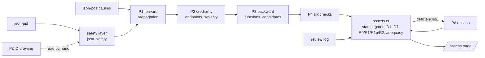

# Staged Safety Assessment: Improvement Plan Phases 1–4

**Plan:** [improve_plan/supernode_prototype_improvement_plan_EN.md](../improve_plan/supernode_prototype_improvement_plan_EN.md), §8, Phases 1–4
**Built:** 2026-10-30 · **Case:** 01, Naphtha Tank 100T-01 with Transfer Pumps 100P-01A/B
**Page:** `/assess/01` (linked from the 3D graph page as **Safety assessment →**)

The single-prompt review at `/lopa/01` and its cache `json_lopa/01_lopa.json` are unchanged. They are kept as the baseline for the later B1–B4 comparison (plan §7.2).

---

## 1. Decisions made before building

| Question | Decision |
|---|---|
| Where do the forward scenarios (P1/P2) come from? | A new stage in this repo, seeded by json-pid and the json-pos causes. json-pos stays the untouched original. |
| How strict is the credit gate? | **R1** counts qualified layers only. A separate **pending band** (R1 + pending) also counts unverified layers that pass applicability and independence. **R2** adds proposals and is conditional. |
| What happens to the old LOPA page? | It is frozen as the baseline; the staged pipeline gets its own page. |
| Paid AI runs during development | A pilot of one deviation only (No Flow / Less Flow). The other eight are run from the page. |
| Does the model see the engineer worksheet? | No. The new prompts are blinded. |
| How is the reviewer identified? | A typed name and role, stored with each decision in an append-only log. There is no login. |

---

## 2. Checklist

### Phase 1: Correct the engineering data

- [x] **Reconcile the P&ID, json-pid and json-pos tags.** The drawing was read page by page and its tags listed in `json_safety/01_safety.json → drawing`. `reconcile()` in `app/utils/safety.ts` compares the sources and only reports: nothing is rewritten. Results appear under **Data checks** on the page.
- [x] **Add structured scenario IDs, path IDs and provenance.**
  - IDs: scenario = `cause_id`, endpoints = `<cause_id>-E<n>`, steps are numbered, required functions = `<endpoint>-F<n>`, candidates = safety-function ID or sorted tags, pairs = `<endpoint>|<candidate>`, deficiencies = `<endpoint>/D<k>/<ref>`, actions = `<endpoint>-A<n>`.
  - Every step is checked against the graph (`stepPath`) and shows the hop count, or "no graph path".
  - P1 records `evidence_refs`. Every run stores the source, prompt and rules versions.
- [x] **Add safety-function and instrument-loop relationships.** The case has 16 safety functions, each with sensors, logic, final elements, utilities and people, plus explicit signal links taken from the drawing (for example LT-0102 → LSHH-0102 → IS-09 → UY-0101 → UV-0102-IN). The operator (`HUM-OPERATOR`) is a shared component, so two alarm layers that rely on the same operator count once.
- [x] **Record missing reliability, design and proof-test evidence.** Each function has an `evidence` block in which `null` means "not available". The page lists them; for case 01 every function lacks evidence.
- **Exit criterion met:** the enriched graph and explicit unresolved and evidence records exist. With the layer's aliases, all 39 json-pos cause sources, all 37 consequence targets and all 65 safeguard targets resolve (before: 29, 29 and 54).

What the reconciliation found in case 01 (unit-tested):

| Finding | Detail |
|---|---|
| LAH/LAL loop | Drawn on LI-0101A (loop 0101: LT-0101 → LY-0101). json-pid tags them LAH-0102 / LAL-0102, which puts them on the LT-0102 trip loop. |
| LSLH-0102A | One drawn instrument fed by LT-0102, with LSHH → IS-09 and LSLL → IS-10. json-pid splits it into LSHH-0102 and LSLL-0102. |
| Inlet UV | Drawn as UV-0102, but its UY and limit switches are numbered 0101, and the outlet valve is also UV-0102. json-pid adds -IN / -OUT; json-pid's own notes say the user referenced UV-0101. |
| TI-0101 | Drawn twice: on the tank (TAH/TAL) and on the pump discharge (data link to FY-0101). json-pid merges them into one instrument. |
| LI-0102A | Drawn connected to LT-0101, not LT-0102. |
| Missing from json-pid | An untagged check valve on 100-P-027 to HPU (in series with the pump check valves) and the suction strainers. |
| Extraction-assigned IDs | AC-0101, the manual valves and the pump check valves have no tags on the drawing. |

### Phase 2: Improve the forward scenarios

- [x] **P1 outputs initiating events, local effects, propagation steps and endpoints.** `backend/module/hazard_scenario.py`: one cause can have several endpoints; the source type can be an element, external condition, human action, process phenomenon or unresolved; P1 also gives the Table B1 class, operating assumptions and evidence references. Safeguards are excluded from this pass.
- [x] **P2 judges credibility and physical plausibility, and classifies endpoints.**
  - Credibility is credible / not_credible / insufficient_evidence, and missing data is never treated as not credible.
  - Endpoint types are process_safety / equipment_protection / operability.
  - P2 also gives severity C-1..C-5 with a reason, the physical basis, unsupported steps and the evidence still needed.
- [x] **Verify paths and isolate uncertain or non-credible transitions.**
  - Every step is checked against the graph.
  - P2 flags steps it does not accept.
  - Not-credible endpoints leave protection review.
  - insufficient_evidence endpoints go on, but can never be judged adequate.
- **Exit criterion met:** the credible endpoint set is visible and can be challenged per scenario: an engineer can revise the initiating event, credibility or severity.

### Phase 3: Build the backward IPL core

- [x] **P3 maps protection functions.** `backend/module/ipl_qualification.py`: it works backward from each credible endpoint to the preventive and mitigative functions needed, then to the existing candidates, each with its intervention point, mechanism and the consequence it addresses. P3 gives no credit.
- [x] **P4 records qualification evidence and status.**
  - P4 rates six checks (applicability, effectiveness, independence, common cause, reliability, auditability) as pass / fail / unknown, each with a basis, plus a Table B2 type and missing evidence.
  - **The status is derived in code, not by the model:** a failed applicability means not_applicable, any other fail means invalid, any unknown means unverified, and otherwise the layer is qualified.
- [x] **D1–D7 deficiencies are classified.** This is done in code (`findDeficiencies` in `app/utils/assess.ts`), from the P3 and P4 results and the risk tables, rather than by a P5 prompt; see §4.
- [x] **Code-based dependency and credit gates:**
  - A layer that shares a component with the initiating cause is blocked (D5).
  - Layers that share a component with each other count once: qualified before pending, then the larger credit (D3).
  - An engineer can confirm independence (logged), which lifts the block.
- **Exit criterion met:** every layer has a traceable status and gate reason; missing protection shows as D1 and missing evidence as D7.

### Phase 4: Safety improvements and risk feedback

- [x] **P6 recommends actions for specific deficiencies.** `backend/module/safety_improvement.py` runs on request, per deviation, for the deficiencies of endpoints that are not adequate. Each action carries:
  - its strategy, target deficiency IDs and Table B2 type (if creditable once verified);
  - existing and new tags, intervention points and mechanism;
  - what it affects (frequency, consequence or evidence only);
  - dependencies, verification requirements, reasoning and process benefit.
- [x] **Proposed measures stay a non-installed overlay.** Actions are stored apart from the as-designed data and listed under **Proposed overlay**. They never enter R1 or R1p. In R2 they count only when they act on frequency, share nothing with the cause or the counted layers, and are not rejected. A claimed consequence reduction is shown but not applied.
- [x] **R0 / R1 / R1p / R2 are kept apart in the calculation and the UI.** Each endpoint row shows all four. The matrix switches between them, and the node cards count I/II at each stage.
- [x] **Reviewer approval, verification and audit history.**
  - `POST /api/assess/<id>/review` appends to `json_review/<id>_review.json`. Each entry records the reviewer, role, time, reason, evidence, change, input versions and analysis run.
  - Decisions: confirm, revise, request verification, reject, accept for further engineering. Revisions merge in order, and a null value returns a field to the AI judgement.
  - The page shows the full log.
- **Exit criterion met:** projected risk never stands in for installed-system risk. R1 is computed only from qualified layers, and proposals and pending layers are labelled conditional everywhere.

---

## 3. How it fits together

| Piece | File |
|---|---|
| Safety layer (systems, sections, conditions, safety functions, drawing tags) | `backend/static/json_safety/01_safety.json` |
| Element IDs and prompt context | `backend/module/safety_graph.py` |
| P1, P2 | `backend/module/hazard_scenario.py` |
| P3, P4 | `backend/module/ipl_qualification.py` |
| P6 | `backend/module/safety_improvement.py` |
| Orchestration, shared policy, versions, resume after failure | `backend/module/assessment.py` |
| API and jobs | `backend/app.py` (`/api/assess/<id>`, `/run`, `/recommend`, `/review`) |
| Results and review log | `backend/static/json_assess/`, `backend/static/json_review/` |
| Reconciliation, aliases, function components | `app/utils/safety.ts` |
| Status, gates, deficiencies, risk stages, adequacy | `app/utils/assess.ts` |
| Graph: condition nodes, signal links, aliases, `pathBetween` | `app/utils/supernode.ts` |
| Page and components | `app/pages/assess/[id].vue`, `AssessScenario.vue`, `AssessEndpoint.vue`, `ReviewDialog.vue` |
| Tests | `test/unit/safety.test.ts`, `test/unit/assess.test.ts` (plus the existing two files; `npx vitest run --project unit`) |

A run saves after every stage. If a stage fails (an API error, or credit running out), **Resume** reruns only the stages still missing, as long as the inputs, prompts and rules have not changed. A run made with older inputs, prompts or rules is marked **stale**.

---

## 4. Where this differs from the plan, and why

1. **P5 is code, not a prompt.** Every D-class can be derived from the P3 and P4 results, the graph and the risk tables:
   - D1: a required function with no candidate;
   - D2: applicability fails;
   - D3: shared components or a common-cause fail;
   - D4: effectiveness or reliability fails;
   - D5: a shared component with the cause, or an independence fail;
   - D6: R1 is still I/II;
   - D7: the layer is unverified, or auditability fails.

   This keeps deficiencies reproducible and testable, as the plan's "AI judges, rules compute" principle intends. A P5 prompt can be added later if engineers want narrative explanations.
2. **The IPL status is derived, not returned.** P4 returns the six checks and code derives the status, so the status always agrees with its checks.
3. **R1p (the pending band) is an extra stage between R1 and R2**, as chosen in §1. With no proof-test or PFD records in case 01, strict R1 equals R0; the pending band shows what the evidence would be worth. R2 builds on R1p, because P6 is asked to close the gap that remains even after pending evidence is confirmed.
4. **Proposals are not drawn in the 3D graph** (plan §9 defers 3D work). The overlay is a data structure and a table on the page.
5. **Sharing a component triggers investigation, not proof.** As the plan's S4-A rule says, shared components block credit until an engineer confirms independence; they do not make a layer invalid.

---

## 5. Pilot run: No Flow / Less Flow

**Not run yet.** The first request on 2026-10-30 failed at P1 because the OpenAI account has no credit ("You have no credits remaining"). The error appeared on the page and no partial result was saved. Once credit is added, press **Analyse (P1–P4)** on *No Flow / Less Flow*, then **Recommend actions (P6)**. The expected cost is five model calls of a few minutes each.

**UI check without AI.** To test the page end to end, a hand-written fixture of two No Flow causes was loaded and then deleted; it is not AI output. It confirmed that:

- steps with no graph link show "no graph path";
- IS-28 is blocked for sharing UV-0102-IN with the inlet-valve cause (D5);
- once an engineer confirms that independence, IS-28 is still counted once with IS-10, because both trip the same pumps (D3);
- review decisions land in the log with reviewer, role, change and versions;
- the P6 request passes validation and fails cleanly without credit.

---

## 6. Limitations and next steps

- The safety layer was read off the drawing by hand and is **unverified**. Loop edges, the LSLH-0102A split and the inlet UV tag all need an engineer to confirm them.
- json-pid is not corrected. The reconciliation report lists what to fix upstream.
- No PFD, setpoint, response-time or proof-test data exists for case 01, so R1 equals R0 until evidence is entered (by revising a layer's checks, with the evidence recorded).
- A proposal that modifies an existing counted layer (for example, upgrading IS-09 to SIL 2) earns no extra R2 credit, because the change in credit is not modelled.
- Phase 5 (T1–T8 controlled cases, B1–B4 comparison, a multi-SuperNode case) is not started.
- Each run sends json-pid, json-pos and the safety layer (derived from SCG Chemicals documents) to OpenAI. The engineer worksheet is no longer sent.
