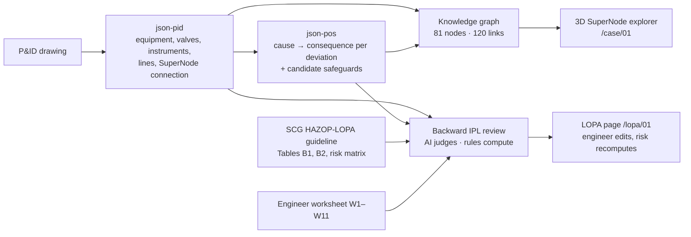

# SuperNode: Work Summary and Ideas for the Next Iteration

**Project:** SuperNode reasoning approach for HAZOP analysis (Master's research, Chemical Engineering, KU)
**Case used:** 01, Naphtha Tank Storage 100T-01 with Naphtha Transfer Pump 100P-01A/B
**Period:** 2026-10-01 to 2026-10-26
**Companion doc:** [backward-ipl-review-demo.md](backward-ipl-review-demo.md) covers the LOPA method, results and review findings in detail. This file takes the project-level view: what the prototype shows about the SuperNode idea, and what to change next.

All numbers below were computed on 2026-10-26 from the files in `backend/static/`.

---

## 1. The idea (from the slides)

| Previous manuscript | SuperNode proposal |
|---|---|
| Nodes are given by a person | Boundaries are derived from P&ID structure and design intent |
| Reasoning stops at the node boundary (unit to unit) | Consequences are traced across SuperNode boundaries along the real flow path |
| Knowledge is a static 50-cause checklist | Causes and consequences are extracted and reasoned together, and updated when new information arrives (likelihood goes up or down) |
| Evaluation measures text similarity only | Not yet defined |

For each SuperNode and guideword, the context is the k-hop propagation closure, the matching cause-ontology entries and the applicable protection layers. Every generated cell records which graph elements it came from.

---

## 2. What was built



### 2.1 3D SuperNode explorer (`/` and `/case/<id>`)

- Search json-pid files by name or number, with suggestions.
- Graph model: each P&ID line is a small node between its endpoints, and valves and instruments hang off the line they sit on. A tag that sits on no line attaches to the equipment named in its location, or else to the SuperNode. Utilities are separate nodes.
- Main flow: the directed paths from the SuperNode's `from_id` to its `to_id` are pinned on a straight START → END line (10 nodes for case 01). Side streams sit above or behind it.
- You pick a deviation and click a node. A red animated path runs from the cause source to the consequence targets. The toggle in the detail panel switches between *No safeguards* (red only) and *IPLs & safeguards* (red + blue).
- The detail panel shows the node's json-pid record and every json-pos entry that names it.
- There are 8 category colours, all checked against the reserved red and blue. The legend works as a filter, and the graph has hover highlight and fly-to-node.
- json-pos is free text, so a resolver finds tags inside it. The longest match wins, "100P-01A/B" expands to both pumps, and boundary aliases such as "HPU" are recognised.

### 2.2 Backward IPL review (`/lopa/<id>`)

- For each json-pos cause, an LLM (gpt-6.1-sol, structured output) judges:
  - severity and the initiating event;
  - whether each existing safeguard is independent, effective and auditable;
  - which IPLs are missing. Each proposal comes with its reasoning, the process benefit and the tags it protects.
- Credits, frequency category and risk rank are computed in code from `lopa_rules.json` (Tables B1 and B2, Appendix G). The engineer can change severity and the initiating event, and tick or untick each IPL. The risk recomputes after every change.
- The page answers the three objective questions for the node: is the protection good, complete, and enough after improvement?

### 2.3 Status

- 27 unit tests pass. They cover the graph model and the LOPA arithmetic, and they reproduce every scored row of the engineer worksheet.
- AI reviews are cached for 5 of 9 deviations (24 of 39 causes). High/Low Level and High/Low Temperature still need a run, which needs OpenAI credit.
- Reviews cached before the reasoning split show one old `rationale` text. Re-running them gives the separate *why* and *process benefit* fields.

---

## 3. What the prototype showed about the idea

### 3.1 Propagation works once a cause is anchored to the graph

29 of 39 causes name a tag the graph can find. For all 29, a path along flow lines reaches every consequence target of the deviation. The structure is enough to trace consequences. The weak point is anchoring causes to the graph, not connectivity.

### 3.2 A quarter of the causes have no node to start from

10 of 39 causes start from a phenomenon or a condition, not a P&ID tag:

| Kind | Cause IDs |
|---|---|
| External fire / environment | PRESS-HIGH-C06, TEMP-HIGH-C02 |
| Ambient cooling | PRESS-LOW-C04, TEMP-LOW-C02 |
| Upstream feed condition | TEMP-HIGH-C01, TEMP-LOW-C01 |
| Trapped / blocked-in liquid | PRESS-HIGH-C05, TEMP-HIGH-C04 |
| Wrong line-up (operator) | FLOW-REV-C02 |
| Evaporation cooling | TEMP-LOW-C03 |

3 of the 4 causes the AI screened out as not credible are on this list (PRESS-HIGH-C06, FLOW-REV-C02, PRESS-LOW-C04). The causes without a node are also the ones whose credibility is disputed. They need explicit handling, not just a resolver miss.

### 3.3 Many consequence targets are systems, not tags

8 of 37 consequence-target mentions and 11 of 65 safeguard-target mentions refer to a system or a section, not a tag. Examples: "Vent/relief system", "Nitrogen blanketing system", "Vent/activated carbon system", "Naphtha transfer piping", "Inlet line", "Pump discharge piping". json-pid has no node for a system or a section, so these targets cannot be drawn or checked. The "derived boundary" idea needs the same thing: a named group of elements that shares one design intent.

### 3.4 Only one SuperNode so far

Case 01 has a single connection, from Existing Process Unit / B-L to HPU, and it covers the whole tank and pump system. The layout can place several SuperNodes (centred, then spread left and right), but the main claim (consequences that cross SuperNode boundaries) has not been tested with data yet. json-pid's `deviation_reasoning` has only 2 entries, both for No Flow.

### 3.5 The graph does not hold the protection structure

- All 30 json-pos safeguard tags resolve to graph nodes, but the graph does not know which sensor drives which alarm, logic solver or valve.
- So only the AI can judge independence (no shared sensor, logic or final element), and it does so from text; code cannot check it. This is Standards finding S2 in the companion doc.
- The LAL tag error comes from this gap. json-pid calls the low-level alarm LAL-0102, and the AI treated it as sharing LT-0102 with LSLL-0102. The P&ID shows LAH/LAL on LI-0101A, fed from LT-0101 through LY-0101. Loop edges checked against the drawing would have caught it.
- There is a second tag mismatch between sources: the user referenced UV-0101, while the extraction has UV-0102-IN. json-pid records this note itself.

### 3.6 Evaluation can go beyond similarity

The LOPA layer produced checks that do not need reference text:

- **Arithmetic:** every scored worksheet row reproduces its recorded `L_after` and `R_after` from its credits.
- **Rule consistency:** W10 and W11 are flagged (S4·L2 is recorded as I, but the matrix gives II).
- **Risk per stage:** reviewed credible scenarios at I/II go 20/20 before IPLs → 18/20 with existing IPLs → 0/20 with all proposals. The last figure holds only if every proposal is validated.
- **Coverage:** 11 scenarios need protection and have no credited IPL.

These checks are a better answer to the "similarity only" limitation than BERTScore alone, as long as the AI's judgement is tested separately in a blinded run (companion doc, finding P4).

### 3.7 Cost

Each deviation takes one large structured call of 105–216 s, so about 9 calls per case. That is fine for a demo. With many nodes, reviews should be cached per input version.

---

## 4. Ideas to improve the SuperNode concept

Ordered by how much each one changes the method. Each idea points to the evidence in Section 3.

### Idea 1: Real provenance, with graph IDs in the output (3.1, 3.3)

The slides say every generated cell records the graph elements it came from. Today json-pos gives cause sources and targets as free text, and the UI guesses the tags with a regex. The fix is to have the reasoning step output IDs alongside the text:

```json
{
  "cause_id": "FLOW-NL-C02",
  "cause_source_ids": ["UV-0102-IN"],
  "consequence_target_ids": ["100T-01", "100P-01A", "100P-01B", "Hydrogen Production Unit HPU"],
  "path_ids": ["100-P-021-A2-1F-4", "100T-01", "…"],
  "cause": "…",
  "propagated_consequence": "…"
}
```

With structured outputs, the allowed IDs can be an enum built from json-pid, so the model cannot invent tags. The LOPA schema already does this for IPL types. This would:

- make anchoring complete, or force an explicit "no element" flag;
- remove unresolved targets;
- let evaluation compare ID sets exactly instead of comparing text.

### Idea 2: New node types for systems, phenomena and external conditions (3.2, 3.3)

- **System / section nodes** group elements: N2 blanketing, vent/relief, inlet section, discharge section. These are candidate derived boundaries.
- **Condition nodes** stand for external fire, ambient temperature and upstream feed condition, each linked to the equipment it acts on.

The k-hop closure then includes these nodes, and the 10 causes without a node get a start point. A screening decision ("not credible") attaches to a node, together with its reason.

### Idea 3: Protection layers inside the graph (3.5)

Add instrument-loop edges (sensor → transmitter → logic / interlock ID → final element) and `protects` edges to the targets. This gives:

- an independence check by graph query: two credited IPLs that share any node count as one layer, and an IPL that shares a node with the cause's own loop is not independent;
- a tag check against the drawing, which would have caught LAL-0102;
- a blue animation that follows the real signal path instead of the nearest line;
- "applicable protection layers" (from the slides) computed instead of guessed: the layers whose loop touches the k-hop closure.

### Idea 4: Derived SuperNode boundaries, tested on a multi-node case (3.4)

Take a second P&ID with at least two process units. Candidate rules for cutting boundaries:

- a change of design intent (storage, transfer, reaction);
- equipment boundaries;
- isolation or check valves at unit interfaces;
- utility tie-ins.

Evaluate by comparing derived boundaries with the nodes engineers assign, and by counting consequences that cross a boundary a node-by-node worksheet would miss. That count is the main evidence for the SuperNode claim.

### Idea 5: Forward and backward passes as one loop (2.2, 3.6)

- **Forward (red):** cause → consequence along the graph.
- **Backward (blue + AI):** consequence → existing layers → missing layers → proposals.
- **Feedback:** add proposals to the graph as *proposed* nodes with loop edges, then re-run the independence query and the risk calculation.

This makes the slides' step concrete ("update and check previous cause and consequence, likelihood up or down"): likelihood = initiating frequency × 0.1^(valid credits), recomputed whenever a node or a layer changes.

### Idea 6: A cause ontology linked to Table B1 (3.2)

Replace the 50-cause checklist with ontology entries keyed by element type and failure mode. Examples: control valve fails closed, pump trips, PCV fails open, check valve leaks, operator line-up error, external fire. Each entry carries its Table B1 initiating-event class and default frequency. A cause found on a node then already has its likelihood basis, and the AI only confirms it or overrides it with a reason. For case 01 the AI review already used 8 classes, which can serve as a starting set: `valve`, `bpcs_loop`, `rotating_equipment`, `check_valve_high_demand`, `fixed_equipment`, `operator_nonroutine`, `operator_weekly`, `not_credible`.

### Idea 7: An evaluation set beyond similarity (3.6)

| Metric | Case 01 today |
|---|---|
| Cause anchoring: causes tied to graph elements | 29 / 39 |
| Propagation reach: anchored causes whose path reaches all targets | 29 / 29 |
| Target resolution: consequence-target mentions tied to elements | 29 / 37 |
| Rule-consistency flags in the reference worksheet | 2 (W10, W11) |
| Reviewed credible scenarios at I/II: before / existing / with proposals | 20 / 18 / 0 (conditional) |
| Independence violations found by graph query | needs Idea 3 |
| Blinded agreement with the engineer on S, L and credited IPLs | not measured yet |
| Cross-boundary consequences missed by a node-by-node worksheet | needs Idea 4 |

Keep BERTScore for text quality and report it next to these.

### Idea 8: A tag check before reasoning (3.5)

Add a check step between extraction and reasoning:

- every tag in json-pos must exist in json-pid;
- every instrument must belong to a loop;
- tags the user referenced that differ from the drawing (UV-0101 vs UV-0102) get flagged.

It is cheap, and it catches errors before they reach the LOPA.

---

## 5. Questions to settle with advisors

1. Is a SuperNode a partition (each element belongs to one SuperNode), or can SuperNodes overlap (a shared line in two)? The answer changes both boundary derivation and cross-boundary counting.
2. What value of k for the k-hop closure, and what counts as a hop? The current trace walks only through lines, equipment and boundaries.
3. Should the tool output a HAZOP worksheet, a HAZOP-LOPA worksheet, or both? The LOPA layer uses company tables (SCG SD-PS-G-0209); a general version would need public tables such as CCPS.
4. Which multi-unit P&ID can be the second case, and can it be published?
5. Can the engineer worksheet be held back from the model and used as a blinded test set?
6. The case 01 documents are SCG Chemicals property, and the AI review sends them to OpenAI. Is this approved for the thesis and for any public code?

---

## 6. Where things are

| Piece | Files |
|---|---|
| Graph model, resolver, traces, main flow | `app/utils/supernode.ts` |
| 3D view and detail panel | `app/components/GraphView.client.vue`, `app/components/NodeDetail.vue`, `app/pages/case/[id].vue` |
| LOPA arithmetic and verdicts | `app/utils/lopa.ts` |
| LOPA page | `app/pages/lopa/[id].vue`, `app/components/LopaRow.vue`, `app/components/RiskMatrix.vue` |
| AI prompt and schema | `backend/module/lopa.py` |
| API and background jobs | `backend/app.py` |
| Company rules (Tables B1, B2, risk matrix) | `backend/static/lopa_rules.json` |
| Input data | `backend/static/json_pid/`, `backend/static/json_pos/`, `backend/static/json_ref/` |
| Cached AI reviews | `backend/static/json_lopa/01_lopa.json` |
| Tests | `test/unit/supernode.test.ts`, `test/unit/lopa.test.ts` (`npx vitest run --project unit`) |

**Run:** `npm run dev:o` (Nuxt on :3000, Flask on :5000), then open `http://localhost:3000`. The AI review needs `backend/.env` (template: `backend/.env.example`).
