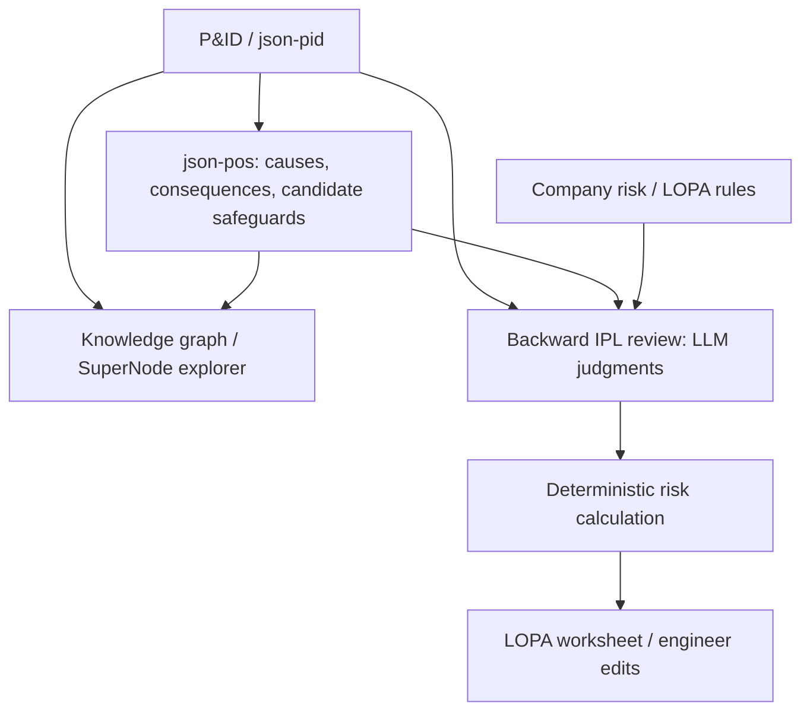
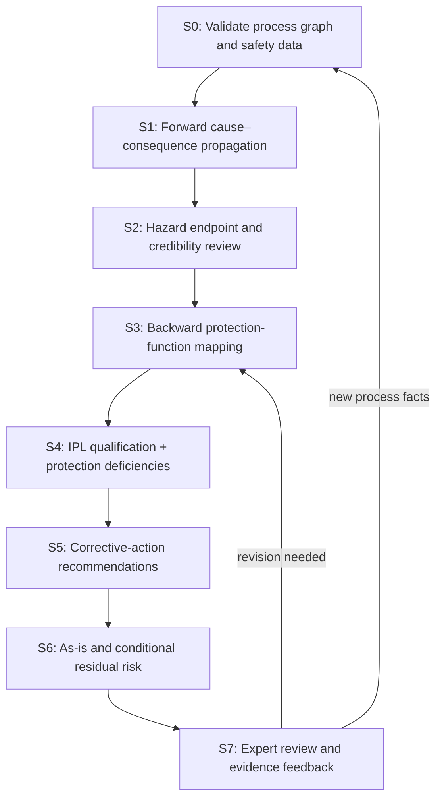

# SuperNode Prototype Improvement Plan

**Research direction:** SuperNode-driven Hazard Propagation and AI-Assisted Backward IPL Adequacy Assessment  
**Document type:** Prototype development and prompt-engineering guide (not a manuscript draft)  
**Prepared:** 29 October 2026  
**Status:** Proposed implementation plan based on the current Prototype Work Summary and Manuscript Design Guide

> **Primary objective:** Upgrade the existing SuperNode HAZOP/LOPA prototype into an engineering-focused safety-assessment system that traces credible hazardous scenarios, evaluates existing protection functions and IPL eligibility, detects protection deficiencies, recommends corrective actions, and verifies *projected* residual risk under explicit assumptions and expert review.

## 1. Research focus and implementation priorities

The revised manuscript emphasizes **Process Safety Engineering**, not the novelty of the AI/graph implementation alone. The target chain is:

**Process topology → SuperNode-based hazard propagation → Hazardous consequence endpoint → Backward protection assessment → IPL deficiency identification → Corrective actions → Residual risk reassessment.**

| Priority | Improvement area | Intended outcome |
|---|---|---|
| P0 | Safety knowledge graph and data validation | Reliable equipment/tag/loop/protection relationships with traceable evidence |
| P1 | Forward hazard scenario analysis | Physically plausible cause–consequence paths with explicit endpoints |
| P1 | Backward IPL adequacy analysis | Scenario-specific qualification, deficiency detection and evidence tracking |
| P1 | Safety improvement and risk reassessment | Deficiency-specific corrective actions and conditional risk comparison |
| P2 | Multi-SuperNode demonstration and evaluation | Test whether propagation improves protection decisions over baselines |
| Later | Automatic partitioning, complex A2A debate, Living KG, advanced 3D visualization | Optional extensions; not critical to the principal safety claim |

**Claim boundary:** The system is a *decision-support tool*, not an autonomous safety-certification or IPL-design authority. A recommendation must not receive risk-reduction credit merely because an LLM generated it.

## 2. Existing prototype: confirmed status and gaps

### 2.1 Existing workflow



According to `supernode-work-summary.md` (26 October 2026):

- Case 01 is **Naphtha Tank Storage 100T-01 and Transfer Pumps 100P-01A/B**.
- Graph representation contains **81 nodes and 120 links**.
- The prototype supports a 3D graph explorer with cause–consequence trace and safeguard display.
- Structured LLM analysis currently evaluates severity, initiating event, existing safeguards and proposed missing IPLs; risk calculation is performed by code from `lopa_rules.json`.
- **27 unit tests** were reported as passing; cached AI reviews covered **5 of 9 deviations, 24 of 39 causes**.
- **29/39 causes** could be anchored by tag to the graph; **29/29** anchored causes had a path to every target of the given deviation. This is **topological reachability**, not proof of physical scenario validity.
- **8/37 consequence target mentions** and **11/65 safeguard target mentions** refer to systems/sections rather than existing tag nodes.
- All **30 candidate safeguard tags** resolved, but the graph lacks complete sensor–logic–final-element relationships for independent IPL assessment.
- The Naphtha case currently represents **one SuperNode**, so cross-SuperNode benefit has not yet been validated.
- The preliminary assessment reported **20/20 → 18/20 → 0/20** reviewed credible scenarios at risk category I/II for unmitigated, existing IPLs, and *all proposed IPLs assumed validated*, respectively. The final value is **conditional, not observed plant risk reduction**.
- Existing review found two risk-matrix consistency flags (W10/W11) and 11 scenarios requiring protection with no credited IPL.

### 2.2 Key limitations and required changes

| Observed issue | Proposed correction | Affected stage |
|---|---|---|
| 10/39 causes have no tag-anchored source (external fire, ambient conditions, operator actions, etc.) | Add condition/event/phenomenon nodes and explicit unanchored status | S0–S2 |
| Systems/sections cannot be resolved to graph entities | Add system/section nodes and endpoint references | S0–S3 |
| No complete instrument-loop structure | Add signal/control/safety-function links and dependencies | S0, S3–S4 |
| LLM infers IPL independence from incomplete textual descriptions | Use graph checks, evidence gates and expert review; do not over-credit | S4 |
| Cause–consequence content has primarily free-text tag mentions | Emit structured IDs, propagation paths, assumptions and provenance | S1–S2 |
| One large LOPA prompt handles several distinct judgments | Split into staged, independently testable prompts | P1–P6 |
| Existing and proposed IPLs can be conflated in what-if interpretation | Separate as-is vs proposed credit and conditional risk outputs | S6–S7 |
| Only one SuperNode in actual case | Add a multi-unit, multi-SuperNode demonstration | Evaluation |

> **Important:** File/module mappings in this guide are based on the project work-summary document, **not a direct inspection of the full source-code repository**. Validate function names and module boundaries against the actual repository before implementing.

## 3. Target analysis pipeline (S0–S7)



### S0 — Graph and safety data validation

**Goal:** Ensure that later LLM decisions refer to correctly linked physical objects and documented evidence.

**Changes**

1. Validate all equipment, valve and instrument tags across P&ID extraction (`json-pid`), scenario data (`json-pos`), and reference records; flag mismatches rather than silently rewriting them.
2. Prefer canonical `element_id` references in generated outputs; allow explicit `unresolved` or `external_condition` source types rather than inventing tags.
3. Extend graph node types to represent **systems/sections**, **external conditions**, **human actions** and **process phenomena** when necessary.
4. Add a **Safety Function** object distinct from a physical instrument or generic safeguard.
5. Link sensor/transmitter, alarm/logic, final element, utility and control/safety dependencies where documented.
6. Capture operating/design limits, setpoints, response time, capacity, proof-test and reliability evidence, including whether fields are missing.
7. Preserve source data; build a **validated/enriched graph layer** rather than overwriting original extraction.

**Required output:** validated graph, reconciliation report, missing-evidence list, traceable source and version IDs.

**Acceptance checks:** tag reconciliation passes for verified items; unresolved references are explicit; known protection loops can be traced to verified components.

### S1 — Forward cause–consequence propagation

**Goal:** Generate a structured unmitigated scenario before considering any safeguard/IPL credits.

**Changes**

- Separate **initiating event**, **local effect**, **propagated effects** and **consequence endpoints**.
- Record each propagation step with its physical mechanism, originating/destination graph IDs and assumptions.
- Allow multiple endpoints from a single cause; do not collapse all consequences into one string.
- Trace directed flow, branch/recycle lines, relevant utility/control dependencies and appropriate cross-SuperNode paths.
- Handle external events and operator actions without creating fake equipment tags.
- Keep safeguards out of this pass, or explicitly mark them as **not credited**.

**Recommended additions:**

`cause_source_ids`, `initiating_event`, `local_effect`, `propagation_steps[]`, `hazard_endpoints[]`, `operating_assumptions[]`, `evidence_refs[]`.

**Acceptance checks:** references resolve; paths are reproducible; all unsupported transitions are flagged.

### S2 — Hazard endpoint and credibility review

**Goal:** Prevent graph reachability or plausible-sounding LLM language from being treated as evidence of physical hazard.

**Checks**

- **Topological validity:** is there a documented or justified path/dependency?
- **Physical plausibility:** does the flow, pressure, inventory, thermal, control or timing mechanism make sense under the operating conditions?
- **Scenario credibility:** is the sequence reasonable in the defined operating mode?
- **Endpoint classification:** process-safety hazard, equipment protection, or operability consequence?
- **Evidence sufficiency:** what assumptions or missing engineering data prevent a reliable judgment?

**Output statuses:** `credible`, `not_credible`, `insufficient_evidence` (do not merge missing data with non-credibility).

**Acceptance checks:** a safety engineer can see and challenge the pathway and its assumptions before protection assessment continues.

### S3 — Backward protection-function mapping

**Goal:** Start with each **hazardous consequence endpoint**, identify the required protective functions, then map actual existing safeguards to those functions.

**Analysis sequence:**

1. Identify a single target hazardous consequence.
2. Determine plausible **preventive and mitigative functions** for that consequence, without automatically prescribing equipment.
3. Retrieve existing candidate safeguards associated with the scenario and functional intervention points.
4. Determine what each safeguard can actually prevent or mitigate.
5. Map `hazard_endpoint → required_protection_function → candidate_safeguard → component_ids`.
6. Do **not** assign IPL credit during candidate discovery.

**Why this matters:** A pump shutdown may prevent pump damage but not prevent downstream feed interruption; one safeguard need not protect every endpoint in a propagated chain.

**Acceptance checks:** each candidate safeguard states the consequence it addresses, its mechanism and its intervention point.

### S4 — IPL qualification and deficiency detection

#### S4-A — Existing IPL qualification

**Goal:** Differentiate a displayed safeguard from a scenario-specific qualified, creditable IPL.

| Check | Typical evidence / assessment |
|---|---|
| Scenario applicability | Does it interrupt or mitigate the specified consequence sequence? |
| Functional effectiveness | Detection, action, capacity, setpoint and response-time evidence |
| Independence | Relationship to initiating event and other credited protection layers |
| Reliability / integrity | Supported PFD / risk-reduction basis, proof testing and maintenance |
| Auditability | Documentation, inspection, testing, functional verification |
| Common cause | Shared sensing, logic, final element, utility or environmental failure mechanisms |

**Statuses:** `qualified`, `invalid`, `not_applicable`, `unverified`.

**Safety rule:** Missing PFD, functional proof or dependency data does **not** prove the hardware failed; however, it must not receive an unsupported LOPA credit. Sharing a node is grounds to **investigate** dependency, not an unconditional proof that every shared-component case violates independence.

#### S4-B — Protection deficiency detection

| Code | Class | Interpretation |
|---|---|---|
| D1 | Missing protective function | No relevant function is identified for a protection need |
| D2 | Inapplicable safeguard | Safeguard does not protect the assessed endpoint |
| D3 | Dependent IPLs | Claimed independent layers have relevant common dependencies |
| D4 | Inadequate performance | Capacity, response or reliability is demonstrably insufficient |
| D5 | Incorrect IPL credit | Credit assigned to an ineligible safeguard, e.g. one whose failure is the initiating event |
| D6 | Insufficient overall risk reduction | Qualified existing layers still do not satisfy risk criteria |
| D7 | Insufficient qualification evidence | Evidence needed to confirm an IPL is missing |

**Important distinction:** D6 does not necessarily mean an IPL is defective. Similarly, missing a candidate IPL does not, by itself, establish that an additional IPL is mandatory without assessment of risk criteria and alternatives.

**Acceptance checks:** deficiencies are classified and grounded; proposed credit cannot pass without qualification; unverified cases escalate rather than receive false assurance.

### S5 — Deficiency-specific safety improvement

**Goal:** Recommend corrective actions for diagnosed protection problems rather than produce a generic list of safety equipment.

Potential strategies include eliminating/reducing the hazard, modifying an existing protective function, adding independent preventive/mitigative measures, improving proof testing, or requesting further study. Administrative safeguards are not automatically treated as independent IPLs.

Every recommendation should contain:

- Deficiency and target endpoint IDs.
- Expected mechanism and intervention point.
- Whether it changes event frequency, consequences, or confidence/evidence only.
- Dependencies and potential common-cause concerns.
- Required engineering verification (e.g. capacity, setpoint, proof test, PFD justification).
- Status such as `candidate`, `needs_verification`, `rejected`, `accepted_for_engineering`.

**Valid outcomes include:** `no_additional_protection_required` and `further_engineering_study_required`.

**Acceptance checks:** no proposal is silently treated as installed or as a qualified IPL; redundant and unnecessary recommendations can be flagged.

### S6 — Risk reassessment and protection adequacy

**Goal:** Make risk results explicitly conditional on documented existing and proposed credit.

| Risk stage | Definition | Output label |
|---|---|---|
| `R0` | Unmitigated scenario risk | No IPL credit |
| `R1` | Risk with verified, existing qualified IPLs | As-is residual risk |
| `R2` | Projected risk with proposed improvements that are evaluated under defined assumptions | **Conditional / what-if residual risk** |

- Keep risk-matrix and LOPA arithmetic **deterministic**; never let the LLM invent or directly set risk credits.
- Preventive IPLs typically act on **frequency/likelihood**, not automatically on intrinsic consequence severity. Mitigative measures may reduce consequences only with substantiated evidence.
- Use frequency/PFD calculations only with defensible event frequencies, conditional modifiers and independence assumptions. Otherwise label outputs as rule-based or semi-quantitative, not fully validated quantitative risk.
- Check matrix consistency; protect the existing regression calculations and address known W10/W11 reference inconsistencies as flags rather than silently modifying the reference.
- Return an adequacy decision: `adequate`, `inadequate`, `undetermined`, with evidence and unresolved actions.

**Acceptance checks:** unverified or merely proposed layers cannot reduce the as-is estimate; all assumptions are displayed beside the what-if result.

### S7 — Expert review and feedback

**Goal:** Make engineering review explicit, traceable and usable for iterative improvement.

**Engineer actions:** `accept_for_further_engineering`, `reject`, `request_verification`, `revise`, `confirm_assessment`.

- Store reviewer identity/role, timestamp, reason, evidence, revision and rule/prompt versions.
- Never overwrite `as_designed` safety data with candidate improvements. Maintain a separate **proposed graph overlay**.
- Re-run relevant dependency and risk checks after an approved change to the *analysis assumptions*.
- Distinguish **accepted for further engineering** from **approved for physical implementation**.

**Acceptance checks:** every risk-credit change and reviewer override is auditable and reproducible.

## 4. Prompt-engineering plan (P1–P8)

The existing `backend/module/lopa.py` combines several engineering judgments in a large structured call. Split the logic into staged prompts, but do not assume one LLM request per prompt per scenario; batch and selectively skip stages where possible.

| Prompt | Current-to-target | Main input | Required output |
|---|---|---|---|
| P1 — Forward Hazard Propagation | Modify existing cause/consequence prompt | Deviation, graph, process intent, cause context | Structured cause, physical propagation and endpoints |
| P2 — Hazard Credibility & Endpoint Review | New | P1 result + process limits | Credibility, classified endpoints, missing evidence |
| P3 — Backward Protection Function Mapping | New; central | Credible endpoint + safety graph | Required functions and mapped existing safeguards |
| P4 — IPL Qualification Assessment | Refactor from LOPA prompt | Safeguards, cause, dependencies, criteria | IPL status, eligibility, basis and missing evidence |
| P5 — Protection Deficiency Analysis | New; central | P3–P4 + risk criteria | D1–D7 deficiencies by endpoint |
| P6 — Safety Improvement Recommendation | Refactor from LOPA prompt | Verified deficiencies and constraints | Deficiency-specific alternatives and verification needs |
| P7 — Engineering Challenger | Optional | Outputs of P2–P6 | Unsupported assumptions / safety objections |
| P8 — Safety Assessment Summary | Optional | Validated results + deterministic risk | Auditable narrative and outstanding issues |

### P1 — Forward Hazard Propagation (modify existing)

**Core instruction**

> Identify credible initiating causes and propagate their physical consequences through the provided process topology. Do not consider safeguards or IPL credits during this pass. Record each propagation step, affected element, physical mechanism, assumptions, and consequence endpoint. Do not invent equipment or instrument tags.

**Fields:** `scenario_id`, `cause_source_ids`, `initiating_event`, `propagation_steps`, `hazard_endpoints`, `evidence_refs`.

### P2 — Hazard Credibility & Endpoint Review (new)

> Evaluate whether the proposed consequence propagation is physically plausible under the supplied operating assumptions. Distinguish process safety hazards from equipment damage and operability effects. Identify unsupported transitions, missing evidence, and the final hazardous event requiring protection review.

**Fields:** `credibility_status`, `endpoint_type`, `physical_basis`, `unsupported_steps`, `required_evidence`.

### P3 — Backward Protection Function Mapping (new; core)

> Starting from the identified hazardous consequence, determine the protective functions that could prevent or mitigate the event. Map existing safeguards to those functions and explain where each function could interrupt the scenario. Do not classify a safeguard as a qualified IPL at this stage.

**Fields:** `required_functions`, `candidate_safeguards`, `intervention_points`, `protected_endpoint_ids`.

### P4 — IPL Qualification Assessment (refactor; core)

> Assess each candidate safeguard for scenario applicability, functional effectiveness, independence, reliability evidence, auditability, and common-cause dependencies. Use only supplied evidence. Return qualified, invalid, not applicable, or unverified. Do not assign IPL credit where qualification evidence is insufficient.

**Fields:** `ipl_status`, `qualification_checks`, `dependency_refs`, `credit_eligibility`, `missing_evidence`.

### P5 — Protection Deficiency Analysis (new; core)

> Identify missing, inapplicable, dependent, inadequate, or incorrectly credited protective functions. Distinguish missing protection from insufficient overall risk reduction. Identify unverified safeguards separately and explain what evidence would resolve the uncertainty.

**Fields:** `deficiency_ids`, `deficiency_type`, `affected_scenarios`, `engineering_basis`, `required_action`.

### P6 — Safety Improvement Recommendation (refactor; core)

> Recommend technically justified corrective actions addressing each identified protection deficiency. Consider hazard elimination, modification of existing protection, additional preventive or mitigative functions, and verification needs. Evaluate applicability, possible dependencies, and limitations. Do not assume a proposed measure is already a qualified IPL.

**Fields:** `proposed_actions`, `target_deficiency`, `expected_protection_mechanism`, `verification_requirements`, `possible_dependencies`.

### P7 — Engineering Challenger (optional)

> Challenge the analysis for unsupported causal links, incorrect safeguard credit, unaddressed common-cause failures, redundant recommendations, and assumptions that could lead to underestimated residual risk. Cite the scenario IDs, graph elements, or missing evidence supporting each objection.

### P8 — Safety Assessment Summary (optional)

> Summarize only the validated scenario, IPL qualification, deficiencies, corrective-action options, remaining evidence gaps and rule-calculated risk states. Distinguish as-is conditions from conditional proposed improvements. Do not add new equipment, credits, or numerical reliability claims.

### Shared prompt rules

These should be included in a common prompt policy and reinforced through post-processing validators:

1. Ground each engineering claim in graph IDs, engineering evidence or an explicitly labeled assumption.
2. Do **not** invent tags, PFD values, initiating event frequencies, physical capacities or proof-test evidence.
3. Distinguish `not_credible`, `not_applicable`, `invalid`, and `insufficient_evidence`.
4. Never count the failed initiating component as an independent protection layer for its own failure scenario.
5. Do not assign proposed or unverified IPL credit to **as-is** risk.
6. Link each corrective action to a specific scenario endpoint and deficiency.
7. Return `requires_engineer_review=true` when material information is unavailable.
8. Emit strict schema-compatible objects; deterministic code validates identifiers, enums, references and numerical rules.

**Execution optimization:** Apply P3/P4 per credible endpoint and candidate safeguard. Only invoke P5/P6 for cases needing deficiency clarification, recommended improvements or unresolved risk; cache by source version, prompt version and risk-rule version.

## 5. Suggested software architecture and file map

**Existing locations** (from Work Summary; verify against repository):

| Existing path | Target changes |
|---|---|
| `app/utils/supernode.ts` | Canonical IDs, typed nodes/edges, path provenance, safety-function dependency access |
| `backend/module/lopa.py` | Orchestrate/refactor large prompt into staged IPL analysis; preserve deterministic rules |
| `app/utils/lopa.ts` | IPL eligibility gates, separate R0/R1/R2, unverified states, rule consistency |
| `backend/app.py` | Stage endpoints, jobs, caching, source/prompt versioning, expert review record |
| `backend/static/lopa_rules.json` | Traceable company criteria; verify rather than silently modify decision tables |
| `backend/static/json_pid/` | Original extraction + versioned graph enrichment |
| `backend/static/json_pos/` | Structured scenario sources, paths, endpoints and evidence IDs |
| `backend/static/json_lopa/` | Qualification, deficiencies, proposals and risk assessments with versions |
| `app/pages/lopa/[id].vue` | Hazard trace, IPL status, deficiency and R0/R1/R2 presentation |
| `app/components/LopaRow.vue` | Evidence, dependency alerts, reviewer decisions |
| `app/components/RiskMatrix.vue` | As-is vs conditional projected-risk views |
| `test/unit/supernode.test.ts` | Graph IDs, external conditions, cross-boundary paths and dependencies |
| `test/unit/lopa.test.ts` | Invalid/unverified credits, numerical consistency, proposal separation |

**Proposed backend modules** (names are recommendations, not confirmed existing files):

```text
backend/module/
├── safety_graph.py           # tag reconciliation, loops, graph validation
├── hazard_scenario.py        # forward propagation, credibility and endpoints
├── protection_mapping.py     # required functions and candidates
├── ipl_qualification.py      # applicable / qualified / invalid / unverified
├── deficiency_analysis.py    # D1-D7 categories
├── safety_improvement.py     # candidate corrective actions
├── safety_validation.py      # output schemas, evidence and review rules
└── lopa.py                   # existing orchestration and deterministic risk
```

**Incremental approach:** Start with `hazard_scenario.py`, `ipl_qualification.py` and `safety_improvement.py`; split further as the implementation matures. Keep validated inputs, AI inferences and expert-approved facts distinct.

### 5.1 Example unified data contract

The following is a conceptual **top-level shape**, not a complete production schema:

```json
{
  "scenario_id": "CASE01-S001",
  "supernode_ids": ["SN-01"],
  "initiating_event": {},
  "cause_source_ids": [],
  "propagation_steps": [],
  "hazard_endpoints": [],
  "credibility_assessment": {},
  "required_protection_functions": [],
  "existing_ipl_assessments": [],
  "identified_deficiencies": [],
  "proposed_improvements": [],
  "risk_assessment": {
    "unmitigated": {},
    "existing": {},
    "proposed_conditional": {}
  },
  "engineering_review": {
    "status": "pending",
    "required_evidence": []
  },
  "metadata": {
    "source_version": null,
    "prompt_version": null,
    "rules_version": null
  }
}
```

Required stable keys in the detailed schema: `scenario_id`, `hazard_endpoint_id`, `function_id`, `ipl_id`, `deficiency_id`, `element_id`, and evidence/version references.

## 6. Frontend improvement plan

Retain the existing LOPA page and 3D graph rather than redesigning the application.

| UI section | Proposed content |
|---|---|
| Hazard scenario trace | Initiating cause → physical propagation → endpoint, with graph and evidence IDs |
| Existing IPL qualification | Function, eligibility, credited/not credited, dependency warnings and missing evidence |
| Protection deficiencies | D1–D7 reason, target endpoint, recommended follow-up |
| Safety improvement options | Candidate measures, technical validation needs, expert decisions |
| Residual risk | R0 unmitigated, R1 as-is, R2 conditional proposed; explicit assumptions |
| Review history | Version, reviewer, rejection/acceptance reason and change record |

Continue red paths for propagated hazards and blue for existing protection if useful, but **draw proposed protection separately** and distinguish candidate from installed/credited layers.

## 7. Evaluation and test plan

### 7.1 Required controlled test cases

| ID | Case | Expected system behavior |
|---|---|---|
| T1 | Missing IPL | Detect protection gap; do not invent existing credit |
| T2 | Invalid IPL | Reject safeguard unrelated to target endpoint |
| T3 | Dependent IPLs | Flag relevant shared-component/common-cause dependencies |
| T4 | Inadequate IPL | Recognize demonstrably insufficient capacity, response or reliability |
| T5 | Incorrect credit | Avoid crediting a component whose failure causes the scenario |
| T6 | Correct protection arrangement | Avoid unnecessary recommendations |
| T7 | Insufficient engineering evidence | Return unverified and specify required evidence |
| T8 | Cross-SuperNode hazard | Identify credible cross-boundary endpoint and applicable protection need |

Each test should be supported by a reviewed reference case, not just an LLM-generated answer. Keep **real process designs** separate from **controlled modifications** and label synthetic changes clearly.

### 7.2 Comparison configurations for the manuscript

| Configuration | Hazard context | IPL method |
|---|---|---|
| B1 | Conventional/local node | Direct LLM review |
| B2 | SuperNode propagation | Direct LLM review |
| B3 | Conventional/local node | Structured backward IPL review |
| B4 (proposed) | SuperNode propagation | Structured backward IPL + qualification rules + risk check |

Use matching process information, the same reference criteria and comparable model settings. Blinded experts should judge technical validity, scenario credibility and proposal quality. A new multi-SuperNode case is needed for the cross-boundary claim.

### 7.3 Engineering-first metrics

**Primary:**

- Protection deficiency recall / precision, reported by D1–D7 class.
- Critical deficiency recall.
- **Unsafe IPL Credit Rate** (invalid candidates credited / invalid candidates evaluated).
- IPL qualification macro-F1 and false assurance rate.
- Recommendation technical validity and expert acceptance for further engineering.
- Agreement on residual-risk and adequacy classifications.
- Projected, **expert-validated under assumptions**, risk reduction / unresolved high-risk scenarios.

**Supporting:**

- Hazard endpoint recall and physical propagation validity.
- Cross-boundary credible scenario coverage.
- Cause/endpoint grounding and provenance coverage.
- Recommendation redundancy rate.
- Runtime, token usage and optional textual similarity (secondary, not safety evidence).

**Statistical / evaluation safeguards:** report scenario counts and per-process results, use blinded adjudication, avoid treating correlated rows as independent samples, and avoid interpreting ordinal risk-category numbers as linear magnitudes.

## 8. Development phases and acceptance criteria

### Phase 1 — Correct the engineering data

- [ ] Reconcile P&ID, `json-pid` and `json-pos` tags.
- [ ] Add structured scenario IDs, path IDs and provenance.
- [ ] Add safety-function and instrument-loop relationships.
- [ ] Record missing reliability, design and proof-test evidence.
- **Exit criterion:** reconciled graph plus explicit unresolved/evidence records.

### Phase 2 — Improve forward scenarios

- [ ] Modify P1 to output initiating events, local effects, propagation steps and endpoints.
- [ ] Add P2 for credibility / physical plausibility and endpoint classification.
- [ ] Verify paths and isolate uncertain/non-credible transitions.
- **Exit criterion:** credible endpoint set that an engineer can inspect.

### Phase 3 — Build backward IPL core

- [ ] Add P3 protection-function mapping.
- [ ] Refactor P4 for explicit qualification evidence/status.
- [ ] Add P5 deficiency classification with D1–D7.
- [ ] Implement code-based dependency and IPL credit gates.
- **Exit criterion:** traceable qualified/invalid/unverified decisions and missing-protection diagnoses.

### Phase 4 — Safety improvements and risk feedback

- [ ] Refactor P6 for deficiency-specific recommendations.
- [ ] Keep proposed measures as non-installed graph overlays.
- [ ] Separate R0/R1/R2 in calculation and UI.
- [ ] Add reviewer approval/verification and audit history.
- **Exit criterion:** projected risk never masquerades as current installed-system risk.

### Phase 5 — Manuscript evidence

- [ ] Build controlled T1–T8 scenarios and expert reference labels.
- [ ] Test B1–B4 under matched conditions.
- [ ] Add at least one genuine multi-SuperNode evaluation case.
- [ ] Report engineering validity, unsafe IPL credit, accepted recommendations and risk adequacy.
- **Exit criterion:** evidence supporting whether the SuperNode-plus-backward method improves process-safety decisions.

## 9. Deferred items

Not necessary for the first publishable safety-focused implementation:

1. Full automatic SuperNode partitioning.
2. Large, complex multi-agent debate and agent-to-agent infrastructure.
3. Living Knowledge Graph or online learning without real verified change history.
4. Extensive 3D enhancements not affecting IPL engineering review.
5. Broad LLM model benchmarking before a sound expert-evaluation protocol exists.

## 10. Minimum implementation package

The **five highest-value deliverables** are:

1. Structured SuperNode-derived causal paths and hazard endpoints.
2. Safety-function, instrument-loop and dependency relationships in the graph.
3. Backward protection mapping + IPL qualification + deficiency classification (P3–P5).
4. Corrective-action review and as-is/conditional risk separation.
5. Expert-validated deficiency cases and B1–B4 comparisons.

**First coding focus:** `backend/module/lopa.py`, the `json-pos` output contract, and `app/utils/supernode.ts`. These are the highest-leverage touchpoints for converting the current HAZOP/LOPA prototype into an engineering-grade *assessment research prototype*. Complete qualification and evidence checks before using results as claims of risk reduction.

---

## Source basis and scope notes

The existing-system statements are based on the supplied materials:

1. `supernode-work-summary.md` — current application, module locations, preliminary measurements and identified issues (especially §§2–4).
2. `supernode_concept.pdf` — conceptual forward cause–consequence and safeguard-mapping workflow (especially pp. 8–16).
3. `supernode-paper-design-review-v1-partitioning.md` — SuperNode context, provenance, PAG, evaluation and engineering/algorithm risks.

The **proposed stages, prompts, module splits, schemas and experiment plan** consolidate the later Manuscript Design Guide and the collaborative Prototype Improvement Plan. They are **development recommendations**, not claims of code already implemented or engineering performance already validated.

**Safety limitation:** The proposed analyses require qualified engineering review before any real-world modification, implementation, SIL assignment, IPL credit, or risk acceptance decision. Missing reliability and design evidence must remain visible rather than being replaced by guessed numbers.
